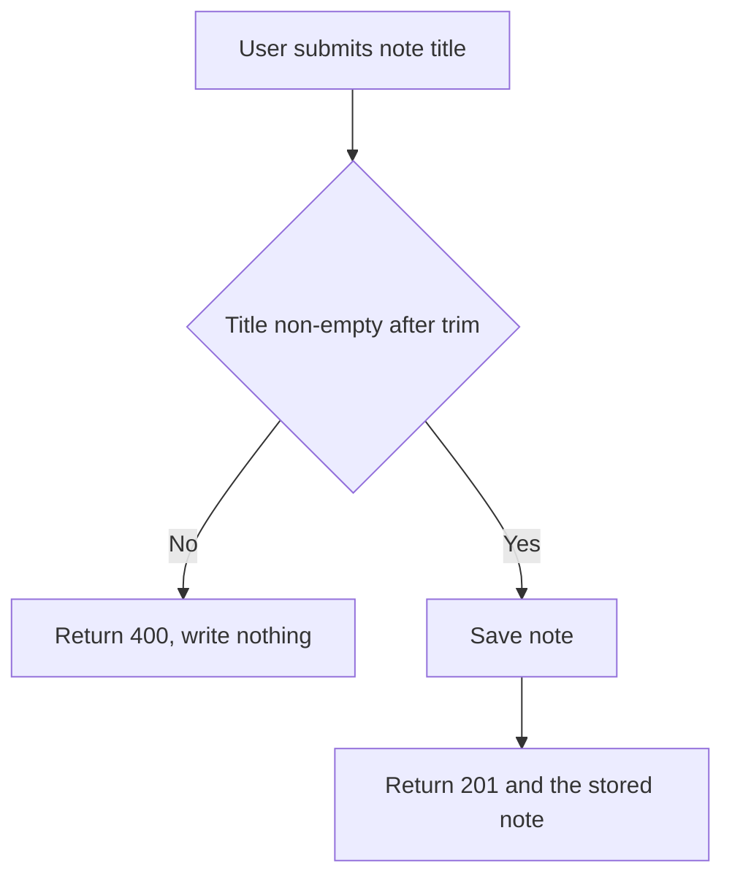

<div align="center">

# backend-spec-flow

**Diagram- and spec-driven backend development for AI coding agents.**

Your agent draws the business flow and data flow first, freezes them into an OpenSpec change,
then implements *only* what those diagrams and scenarios allow.

[](LICENSE)
[](https://agentskills.io)
[](https://github.com/Fission-AI/OpenSpec)
[](https://skills.sh)

[English](#english) · [中文](#中文)

</div>

---

## English

### What it does

`backend-spec-flow` is an [Agent Skill](https://agentskills.io) for backend features and data pipelines. For every feature it produces, in order:

| Phase | Output |
| --- | --- |
| 1. Scope | The goal, entry point, participants, I/O, and an explicit **not-doing** list |
| 2. Diagrams | A Mermaid **business flow** diagram and a Mermaid **data flow** diagram (sequence / state / ER only when the feature needs them) |
| 3. Spec | An OpenSpec change: `proposal.md` → `design.md` → `specs/<capability>/spec.md` → `tasks.md`, with numbered design rulings and node-invariant tables |
| 4. Implementation | Code and tests that follow the recorded paths, nothing more |
| 5. Verification | `verification.md` mapping requirement → diagram node → code symbol → real test evidence |

### Why

Coding agents default to defensive over-engineering: retries nobody asked for, a cache "for safety", a fallback branch, a compatibility layer, an abstraction over a single call site. That work is hard to review and impossible to trace back to a requirement.

This skill removes the ambiguity. The diagrams and OpenSpec change become the authority, and the design must contain a concrete, testable **MUST NOT** list. A new mechanism needs a requirement and a diagram update *before* it can exist in code.

### Install

```sh
npx skills add xxy757/backend-spec-flow
```

Manual install — clone into your runtime's skills directory:

```sh
git clone https://github.com/xxy757/backend-spec-flow.git \
  ~/.claude/skills/backend-spec-flow          # Claude Code
# or ~/.codex/skills/backend-spec-flow        # Codex
# or ~/.pi/agent/skills/backend-spec-flow     # Pi
# or .claude/skills/backend-spec-flow         # project-scoped
```

**Requires:** a Mermaid-capable viewer and the [OpenSpec CLI](https://github.com/Fission-AI/OpenSpec) ≥ 1.4.1 (validated against 1.4.1):

```sh
npm install -g @fission-ai/openspec
openspec --version
```

Without OpenSpec the diagrams still work, but the spec, task and verification phases degrade to plain Markdown files. The skill will say so instead of pretending the workflow ran.

### The loop

1. **Scope** — confirm whether the request is design, implementation or acceptance, and stop at the authorized phase. Read the project's existing OpenSpec changes, diagrams, code and tests.
2. **Draw** — business flow plus data flow are mandatory; sequence, state and ER diagrams only when the feature actually has cross-module calls, a lifecycle, or persisted relations. Every branching node gets a row in an invariant table: allowed condition, forbidden behavior, exact error code or state.
3. **Specify** — write the contract into OpenSpec with numbered rulings. Each ruling carries an exact identifier (error code, state value, field, event name, `file:symbol` anchor), at least one testable prohibition, and the diagram node it governs.
4. **Implement** — small tasks bound to requirement and diagram node. New business branches, states, external calls or persistence side effects require the design to change first.
5. **Accept** — run the tests, run `openspec validate <change> --strict`, and fill the verification table with real evidence. Skipped and blocked items stay visible.

### What it refuses to add on its own

- Business branches, states or status values not in the requirement
- Automatic retries, degradation/fallback paths, caches, compatibility layers
- Background jobs, queues, notifications, generic CRUD base classes
- "Defensive hardening" that widens the task without a requirement behind it
- Retro-editing diagrams to make an implementation deviation look compliant

It also refuses to delete what the design still needs: existing authorization, input validation, transactions and data-consistency rules stay, just stated minimally.

### Example

A worked example (`create a note`) lives in [`references/worked-example.md`](references/worked-example.md). The business diagram it produces:



Its data flow diagram, spec, tasks and verification table are in the same file. They are documentation, not a tested feature — and the skill is explicit about that distinction.

### Repository layout

```
SKILL.md                       # skill definition (Chinese), the only entry point
agents/openai.yaml             # display metadata for OpenAI-compatible runtimes
references/
  design-contract.md           # diagram rules, invariant tables, ruling precision
  openspec-workflow.md         # OpenSpec 1.4.1 CLI sequence, apply loop, validation
  worked-example.md            # end-to-end example change
assets/backend-diagram-flow/   # OpenSpec custom schema + four artifact templates
  schema.yaml
  templates/{proposal,design,spec,tasks}.md
```

### Adapting it

- **Use it as-is:** the skill copies `assets/backend-diagram-flow/` into `openspec/schemas/` for a new change, validates it, and creates the change with that schema. Your project default schema and existing changes are left alone.
- **Keep your own spec system:** the diagram rules and the design-confirmation discipline in `references/design-contract.md` are tool-agnostic. Replace the OpenSpec sections with your equivalent, but keep the mandatory diagrams, node invariants, numbered rulings and verification table — those are what make the workflow enforceable.
- **Change the language:** `SKILL.md`, references and templates are Chinese. The English README plus `references/worked-example.md` is enough to translate; keep node IDs (`B_*`, `D_*`) stable when you do.

### Limitations

- The skill body is Chinese; only this README and the schema instructions' structure are English.
- Tightly coupled to OpenSpec CLI 1.4.1 behavior. Newer or older versions may need `openspec instructions`/`apply` adjustments — run `openspec --help` first.
- Mermaid is validated by reading or by whatever renderer your environment has. If nothing can render it, the skill writes "render not verified" rather than claiming a pass.
- Design confirmation is a human gate. The skill records the user's actual confirmation and refuses to self-approve, but nothing enforces that beyond the agent following the instructions.

### License

MIT — see [LICENSE](LICENSE).

---

## 中文

### 它做什么

`backend-spec-flow` 是一个面向后端业务功能和数据链路的 [Agent Skill](https://agentskills.io)。对每个功能，它按顺序产出：

| 阶段 | 产物 |
| --- | --- |
| 1. 明确范围 | 目标、入口、参与者、输入输出，以及明确的**不做**清单 |
| 2. 画图 | Mermaid **业务流程图**和**数据流图**（时序图／状态图／ER 图只在功能确实需要时补） |
| 3. 写规格 | OpenSpec change：`proposal.md` → `design.md` → `specs/<capability>/spec.md` → `tasks.md`，含编号技术裁定与节点不变量表 |
| 4. 最小实现 | 只实现这些路径允许的代码和测试 |
| 5. 验收 | `verification.md` 把需求 → 图节点 → 代码符号 → 真实测试证据串起来 |

### 为什么需要

编码 Agent 默认会做防御性过度设计：没人要求的重试、为“保险”加的缓存、多余兜底分支、兼容层、只调用一次的抽象层。这些东西难评审，也追溯不到任何需求。

这个 Skill 把裁量权收走：图和 OpenSpec change 是权威，设计里必须写明可测试的 **MUST NOT** 清单。想加新机制，先有需求、先改图和规格，代码里才允许出现。

### 安装

```sh
npx skills add xxy757/backend-spec-flow
```

手动安装：克隆到对应 runtime 的 skills 目录

```sh
git clone https://github.com/xxy757/backend-spec-flow.git \
  ~/.claude/skills/backend-spec-flow          # Claude Code
# 或 ~/.codex/skills/backend-spec-flow        # Codex
# 或 ~/.pi/agent/skills/backend-spec-flow     # Pi
# 或 .claude/skills/backend-spec-flow         # 项目级
```

**依赖：** 能渲染 Mermaid 的阅读器，以及 [OpenSpec CLI](https://github.com/Fission-AI/OpenSpec) ≥ 1.4.1（本仓库按 1.4.1 验证）：

```sh
npm install -g @fission-ai/openspec
openspec --version
```

没有 OpenSpec 时图照样能画，但规格、任务和验收会退化为普通 Markdown；Skill 会如实说明，而不是假装流程跑通了。

### 工作流

1. **明确范围** —— 先分清用户要的是设计、实现还是验收，只做到被授权的阶段。读项目已有的 OpenSpec change、图、代码和测试。
2. **画图** —— 业务流程图和数据流图必需；跨模块调用、业务生命周期、持久化实体关系才补时序图、状态图、ER 图。每个带规则的分支节点都要有不变量表一行：允许条件、禁止行为、精确错误码或状态。
3. **写规格** —— 把契约写进 OpenSpec，技术决策逐条编号。每条裁定带精确标识符（错误码、状态值、字段、事件名、`file:symbol` 锚点）、至少一个可测试禁令，以及它约束的图节点。
4. **最小实现** —— 任务拆小并绑定需求和图节点。新增业务分支、状态、外部调用或持久化副作用，必须先改设计。
5. **对照验收** —— 跑测试、跑 `openspec validate <change> --strict`，把真实证据填进对应表。跳过和被阻塞的项保持可见。

### 它不会自行添加什么

- 需求里没有的业务分支、状态或状态值
- 自动重试、降级兜底、缓存、兼容层
- 后台任务、队列、通知、通用 CRUD 基类
- 没有需求依据的“防御性加固”
- 为了掩盖实现偏离而事后改图、改规格

它也不会删掉设计真正需要的东西：现有权限控制、输入校验、事务和数据一致性要求仍然保留，只是写得更精确。

### 示例与结构

完整示例（创建便签）见 [`references/worked-example.md`](references/worked-example.md)，包含业务流程图、数据流图、规格、任务和验收表。示例只说明颗粒度，不代表已验证的功能。

```
SKILL.md                       # Skill 定义（中文），唯一入口
agents/openai.yaml             # OpenAI 兼容 runtime 的展示信息
references/
  design-contract.md           # 图规则、不变量表、裁定精度
  openspec-workflow.md         # OpenSpec 1.4.1 CLI 顺序、apply 循环、校验
  worked-example.md            # 端到端示例 change
assets/backend-diagram-flow/   # OpenSpec 自定义 schema + 四个产物模板
```

### 适配你的项目

- **直接使用**：新建 change 时把 `assets/backend-diagram-flow/` 复制到 `openspec/schemas/`，校验通过后用该 schema 建 change；不改项目默认 schema，也不迁移旧 change。
- **换规格工具**：`references/design-contract.md` 里的画图规则和设计确认纪律与工具无关。保留必需的两张图、节点不变量、编号裁定和验收对应表——这些才是流程能被执行的原因。
- **换语言**：`SKILL.md`、references、templates 目前是中文。翻译时保持 `B_*`、`D_*` 节点 ID 稳定，图和规格的链接才不会断。

### 限制

- Skill 正文为中文，只有 README 和 schema 的指令结构面向英文读者。
- 深度依赖 OpenSpec CLI 1.4.1 的行为；版本变化时先跑 `openspec --help` 再调整命令。
- Mermaid 只做人工或环境已有工具的渲染校验；环境里没有渲染器时，会明确写“未验证渲染”，不会当作通过。
- 设计确认是人工闸门。Skill 记录用户真实确认语句并拒绝自批，但这依赖 Agent 遵守指令，没有额外的自动化强制。

### 协议

MIT，见 [LICENSE](LICENSE)。
