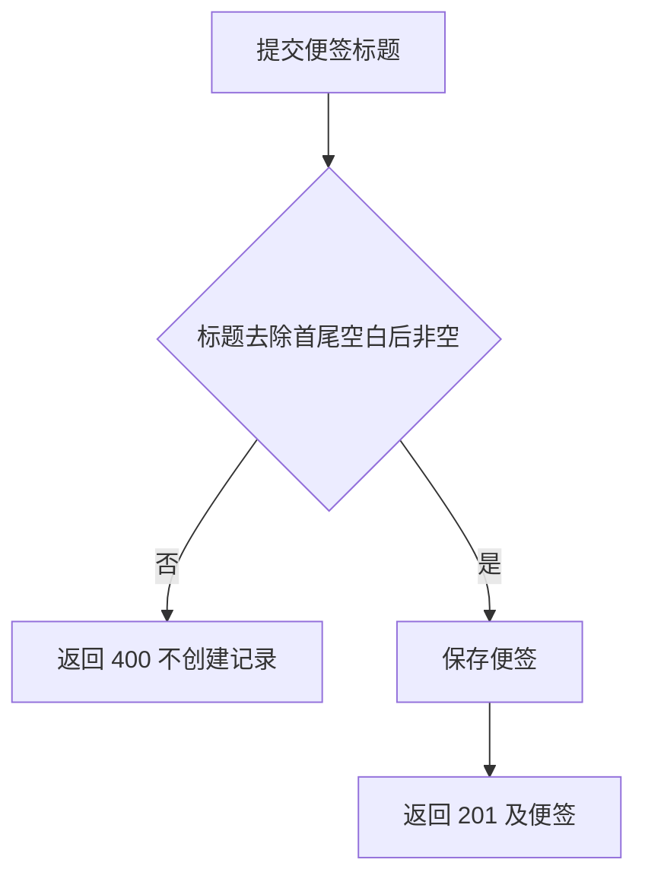
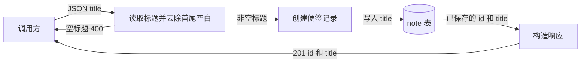
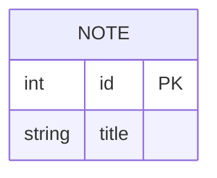

# 示例：创建便签

这是文档颗粒度与关联方式的示例，不是已经实现或验收的功能。设计保持草稿，确认依据和测试结果均不虚构。真实任务应使用真实领域、接口与项目约定。

## 示例文件：proposal.md

## Why

用户需要创建只有标题的便签，并获得持久化后的编号。

## What Changes

增加创建便签接口，返回保存后的编号和标题；标题为空时拒绝请求。
本次不做自动重试、缓存、后台任务或通知。

## Capabilities

### New Capabilities

- `notes`: 创建便签及标题校验。

### Modified Capabilities

无。

## Impact

涉及 POST /notes 和 note 数据表。查看[业务与数据流程](design.md)。

## 示例文件：design.md

# 设计与流程

## 设计确认

| 项目 | 内容 |
| --- | --- |
| 设计版本 | D1 |
| 状态 | 草稿 |
| 对应规格 | [便签规格](specs/notes/spec.md) |
| 确认范围 | 尚未确认 |
| 用户确认依据 | 尚无；本文件仅为示例。 |

## 范围与非目标

用户提交标题，系统保存便签并返回结果。只涵盖标题非空校验与创建。
不增加自动重试、缓存、状态机、通知或通用 CRUD 基类。

## 业务流程图

## 数据流图

## 补充视图

新增持久化实体，补充 ER 图。本例只展示逻辑字段，数据库具体类型沿用目标项目约定。

无跨业务模块或外部服务调用，不补时序图；无业务生命周期，不补状态图。

## 技术决策与最小实现约束

沿用项目现有接口、业务处理与数据库访问方式。数据写入仅包含便签创建，不引入额外职责层。
标题去除首尾空白后为空则返回 400，不写数据库。保存成功返回 201、编号及规范化后的标题。
没有本次专属存储故障处理要求时沿用项目现有错误响应，不新增自动重试或假成功兜底。

## 未决问题

此为示例。实际使用时应先核对项目的接口、编号类型与现有权限约定，再提交设计确认。

## 示例文件：specs/notes/spec.md

## Purpose

Provide a minimal note creation capability that stores a normalized title and returns its identifier, so callers can create and reference a persistent note without introducing unrelated lifecycle features.

## ADDED Requirements

### Requirement: Create a note

The system SHALL accept POST /notes with a string title, trim leading and trailing whitespace, and persist a note only when the resulting title is non-empty.

关联 [design.md](../../design.md) 的业务路径 B_SUBMIT → B_CHECK → B_SAVE → B_RETURN，以及数据路径 D_INPUT → D_WRITE → D_DB → D_RESPONSE。

#### Scenario: Create with a non-empty title

- **WHEN** the caller submits a title of " example "
- **THEN** the system creates one note with title "example" and returns HTTP 201 with the stored note's id and title

#### Scenario: Reject an empty title

- **WHEN** the caller submits a title containing only whitespace
- **THEN** the system returns HTTP 400 and creates no note

对应拒绝路径：B_CHECK → B_REJECT；数据路径：D_INPUT → D_CLIENT。

## 示例文件：tasks.md

## 1. 实现

前提：设计 D1 已由用户确认。当前示例尚未确认，不能据此开始实施。

- [ ] 1.1 实现 Create a note 的非空标题创建场景；对照 B_SAVE、B_RETURN 与 D_WRITE、D_DB、D_RESPONSE。
- [ ] 1.2 实现 Reject an empty title 场景；对照 B_CHECK、B_REJECT 与 D_INPUT 的拒绝输出。

## 2. 验证

- [ ] 2.1 验证返回的标题已去空白、响应为 201 且仅新增一条记录；验证空标题返回 400 且不写入记录。
- [ ] 2.2 核对没有新增设计外的重试、缓存或持久化副作用，记录图、规格、实现与测试证据。

## 示例文件：verification.md

| OpenSpec 需求／场景 | 图文件与节点／路径 | 实现位置 | 实际测试证据与结果 |
| --- | --- | --- | --- |
| Create a note / Create with a non-empty title | design.md：B_SAVE → B_RETURN；D_WRITE → D_DB → D_RESPONSE | 未实现 | 未运行 |
| Create a note / Reject an empty title | design.md：B_CHECK → B_REJECT；D_INPUT → D_CLIENT | 未实现 | 未运行 |

示例不代表行为验证通过。真实验收应替换为代码路径和符号、实际命令、结果及失败或跳过原因；Mermaid 渲染与 OpenSpec 结构校验分别记录。
